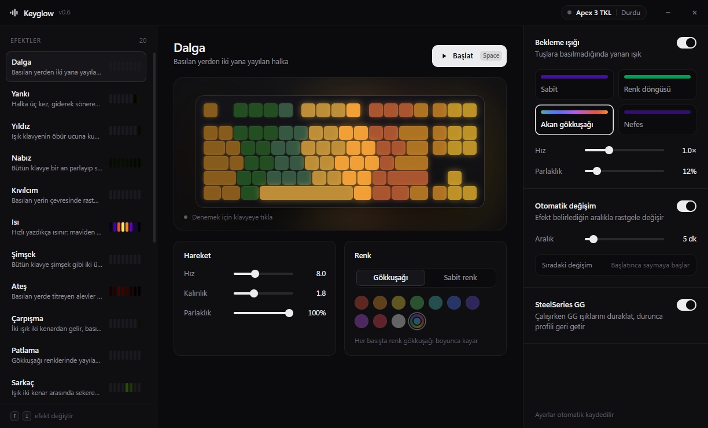
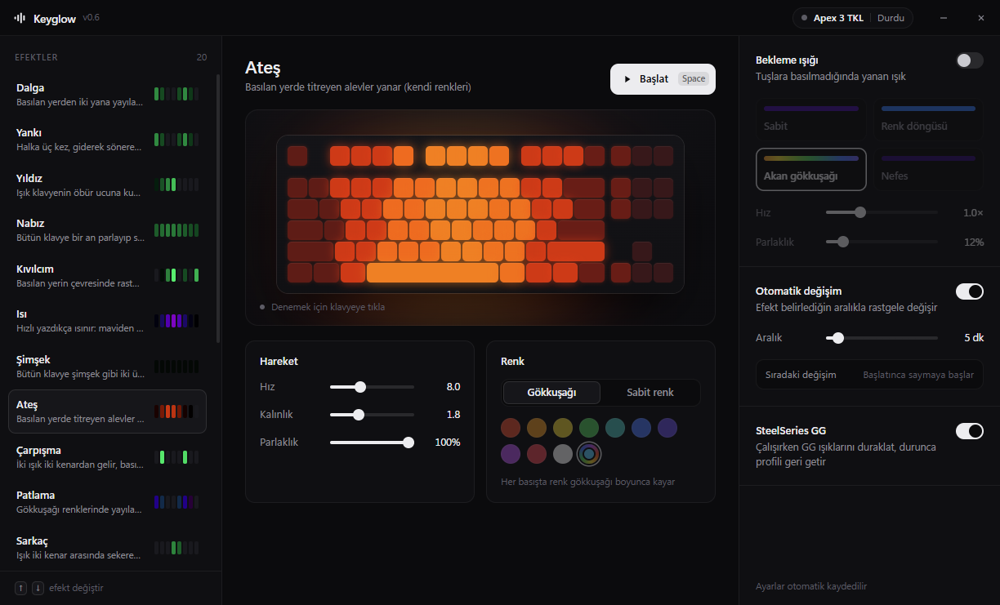
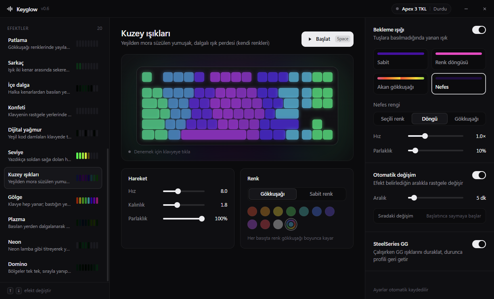

<div align="center">

# Keyglow

**SteelSeries Apex 3 TKL için tuşa bastıkça yayılan RGB ışık efektleri**

20 efekt · canlı klavye önizlemesi · otomatik efekt değişimi · SteelSeries GG ile uyumlu



</div>

---

## İçindekiler

- [Özellikler](#özellikler)
- [Efektler](#efektler)
- [Kurulum](#kurulum)
- [Kullanım](#kullanım)
- [SteelSeries GG ile birlikte kullanım](#steelseries-gg-ile-birlikte-kullanım)
- [Nasıl çalışır](#nasıl-çalışır)
- [Proje yapısı](#proje-yapısı)
- [Sorun giderme](#sorun-giderme)
- [Teşekkür](#teşekkür)
- [Yasal not](#yasal-not)

## Özellikler

- **20 tepkisel efekt:** Dalga, Ateş, Kuzey ışıkları, Şimşek, Isı haritası ve daha fazlası. Her biri bastığın tuşun klavyedeki gerçek konumundan başlar.
- **Canlı önizleme:** Arayüzdeki klavye, gerçek klavyende yanan ışığın birebir aynısını gösterir. Program durmuşken önizlemeye tıklayarak efektleri klavyeyi açmadan deneyebilirsin.
- **Efekt galerisi:** Listedeki her efektin yanında o efekti sürekli oynatan küçük bir önizleme vardır.
- **Bekleme ışığı:** Tuşa basılmadığında yanan ışık için dört mod: Sabit, Renk döngüsü, Akan gökkuşağı ve Nefes. Nefes modu seçili renkle, renk döngüsüyle ya da gökkuşağıyla çalışabilir. Hız ve parlaklık ayarlanabilir.
- **Otomatik değişim:** Efekt, belirlediğin aralıkta (1-60 dakika) rastgele başka bir efekte geçer.
- **SteelSeries GG uyumu:** Keyglow çalışırken GG'nin kendi ışıkları duraklatılır, durunca GG profilin geri gelir. GG'yi kapatman gerekmez.
- **Kurulum gerektirmeyen sürücü:** Klavyeyle Windows'un kendi HID arayüzü üzerinden konuşur. Ek sürücü ya da SteelSeries yazılımı gerekmez.
- **Ayarlar otomatik kaydedilir** ve program açılınca kaldığın yerden devam eder.

<table>
  <tr>
    <td></td>
    <td></td>
  </tr>
  <tr>
    <td align="center"><sub>Ateş efekti</sub></td>
    <td align="center"><sub>Kuzey ışıkları ve Nefes bekleme modu</sub></td>
  </tr>
</table>

## Efektler

| Efekt | Açıklama |
|---|---|
| **Dalga** | Basılan yerden iki yana yayılan halka |
| **Yankı** | Halka üç kez, giderek sönerek tekrarlanır |
| **Yıldız** | Işık klavyenin öbür ucuna kuyruğuyla kayar |
| **Nabız** | Bütün klavye bir an parlayıp söner |
| **Kıvılcım** | Basılan yerin çevresinde rastgele kıvılcımlar çakar |
| **Isı** | Hızlı yazdıkça klavye ısınır: maviden kırmızıya, sonra beyaza |
| **Şimşek** | Bütün klavye şimşek gibi iki üç kez çakar |
| **Ateş** | Basılan yerde titreyen alevler yanar |
| **Çarpışma** | İki ışık iki kenardan gelir, basılan yerde çarpışıp patlar |
| **Patlama** | Gökkuşağı renklerinde yayılan halka |
| **Sarkaç** | Işık iki kenar arasında sekerek gidip gelir |
| **İçe dalga** | Halka kenarlardan basılan yere doğru daralır ve orada parlar |
| **Konfeti** | Klavyenin rastgele yerlerinde rengârenk ışıklar çakar |
| **Dijital yağmur** | Yeşil kod damlaları titreşerek söner |
| **Seviye** | Yazdıkça soldan sağa dolan hız göstergesi |
| **Kuzey ışıkları** | Yeşilden mora süzülen yumuşak ışık perdesi |
| **Gölge** | Klavye hep yanar, bastığın yer bir an kararır |
| **Plazma** | Basılan yerden dalgalanarak yayılan akışkan ışık |
| **Neon** | Neon lamba gibi titreyerek yanar, sonra söner |
| **Domino** | Bölgeler tek tek, sırayla yanıp söner |

Hız, Kalınlık ve Parlaklık ayarları her efekte uygulanır. Renk modu "Gökkuşağı" ya da "Sabit renk" olabilir. Isı, Ateş, Dijital yağmur, Seviye ve Kuzey ışıkları kendi renk paletlerini kullanır.

## Kurulum

**Gerekenler**

- Windows 10 veya 11
- [Python 3.10+](https://www.python.org/downloads/)
- SteelSeries Apex 3 TKL (USB kimliği `1038:1622`)

**Adımlar**

```bash
git clone https://github.com/alperendilaver/keyboard-rgb-effects.git
cd keyboard-rgb-effects
pip install keyboard pywebview
```

Arayüz, Windows 11'de hazır gelen Microsoft Edge WebView2 ile çalışır. Windows 10'da yüklü değilse [buradan](https://developer.microsoft.com/microsoft-edge/webview2/) kurabilirsin.

## Kullanım

```bash
py dalga.py
```

`start dalga.bat` dosyasına çift tıklayarak da başlatabilirsin.

1. Soldaki listeden bir efekt seç. ↑ ve ↓ tuşlarıyla da gezebilirsin.
2. Önizlemeye tıklayarak efekti dene.
3. **Başlat**'a bas ya da `Space` tuşunu kullan. Artık yazdıkça klavyen ışıldar.
4. Sağ panelden bekleme ışığını, otomatik değişimi ve GG ayarını düzenle.

pywebview kurulu değilse ya da `py dalga.py --klasik` ile başlatırsan, daha sade Tkinter arayüzü açılır. Bu arayüzde otomatik değişim yoktur.

## SteelSeries GG ile birlikte kullanım

GG açıkken klavyeye sürekli kendi ışık efektini gönderir ve bu, Keyglow'un renkleriyle karışır. Bunu önlemek için Keyglow çalışırken GG'nin ışık motorunu (`SteelSeriesEngine.exe` ve `SteelSeriesPrism.exe`) geçici olarak **dondurur**, durunca kaldığı yerden **devam ettirir**:

- GG'nin geri kalanı (Sonar, arayüz vb.) etkilenmez.
- Durdurduğunda GG profilin kendiliğinden geri gelir.
- Keyglow beklenmedik şekilde kapanırsa, bir sonraki açılışta donuk kalan süreçler otomatik olarak devam ettirilir. GG'yi yeniden başlatmak da sorunu çözer.

Bu davranışı sağ paneldeki **SteelSeries GG** anahtarıyla kapatabilirsin. OpenRGB gibi başka bir RGB yazılımı kullanıyorsan Keyglow'u çalıştırmadan önce onu kapat.

## Nasıl çalışır

```
 Tuş basışı ──► keyboard (global hook) ──► scan code → klavyedeki x konumu → bölge (0-8)
                                                          │
                                                          ▼
                         Efekt motoru (dalga.py) — her karede 8 bölgenin rengini hesaplar
                                │                                   │
                                ▼                                   ▼
           apex_hid.py: 65 baytlık HID paketi            arayuz_web.py → WebView arayüzü
           (Windows hid/setupapi DLL'leri, ctypes)         (canlı önizleme, 30 fps)
```

- Apex 3 TKL'nin ışıkları tuş tuş değil, **8 bölge** halinde kontrol edilir. Efektler bu 8 bölge üzerinde, tuşun fiziksel konumuna göre hesaplanır.
- Klavyeye her karede `0x21` komutuyla 8 bölgenin R, G, B değerleri gönderilir. Sadece ışıklar değiştiğinde paket gönderilir.
- Arayüz HTML, CSS ve JavaScript ile yazılmıştır ve [pywebview](https://pywebview.flowrl.com/) ile yerel bir pencerede açılır. Derleme adımı ya da Node.js gerekmez.

## Proje yapısı

| Dosya | Görevi |
|---|---|
| `dalga.py` | Efekt motoru, ayarlar ve klasik Tkinter arayüzü. Giriş noktası |
| `arayuz_web.py` | Modern arayüzü motora bağlayan pywebview köprüsü |
| `arayuz/` | Arayüzün HTML, CSS ve JS dosyaları |
| `apex_hid.py` | Klavyeyle USB HID üzerinden doğrudan iletişim |
| `gg.py` | SteelSeries GG ışık motorunu duraklatma ve devam ettirme |
| `apex_dalga_v2.py` | Arayüzsüz ilk sürüm (orijinal) |
| `ayarlar.json` | Kaydedilen ayarlar, otomatik oluşur (git'e eklenmez) |

## Sorun giderme

| Sorun | Çözüm |
|---|---|
| "Klavye bulunamadı" | Klavyenin takılı olduğundan ve OpenRGB gibi başka bir RGB programının kapalı olduğundan emin ol |
| Renkler titriyor ya da karışıyor | Sağ paneldeki **SteelSeries GG** anahtarının açık olduğunu kontrol et |
| Durdurduktan sonra ışıklar sönük kaldı | GG'yi açıp profilini yeniden seç ya da klavyeyi çıkarıp tak |
| Arayüz açılmıyor | `pip install pywebview` ile kur ya da `py dalga.py --klasik` ile eski arayüzü kullan |
| Başka bir SteelSeries klavyem var | Şu an sadece Apex 3 TKL destekleniyor. Diğer modellerin USB kimliği ve ışık bölgeleri farklıdır |

## Teşekkür

Keyglow, **[savcizz](https://github.com/savcizz)** tarafından yazılan **Dalga** projesinin ([savcizz/dalga](https://github.com/savcizz/dalga)) bir fork'udur. Proje dosyalarının adlarında hâlâ bu orijinal ad (`dalga.py` gibi) kullanılıyor. Apex 3 TKL ile doğrudan HID iletişimi, bölge tabanlı dalga efekti ve ilk arayüz orijinal projeye aittir. Bu fork onların üzerine yeni efektler, modern bir arayüz, SteelSeries GG uyumu ve otomatik efekt değişimi ekler.

Orijinal yazara Instagram'dan da ulaşabilirsin: [@savcizz](https://instagram.com/savcizz)

## Yasal not

Bu proje bağımsız, resmi olmayan bir hobi projesidir. **SteelSeries ile bir bağlantısı yoktur** ve SteelSeries tarafından onaylanmamış ya da desteklenmemektedir. "SteelSeries", "Apex" ve "SteelSeries GG", SteelSeries ApS'nin ticari markalarıdır ve burada yalnızca uyumlu donanımı belirtmek için kullanılmıştır. Proje herhangi bir SteelSeries yazılımı, kodu ya da görseli içermez. Kullanım sorumluluğu kullanıcıya aittir.
